<!--
  Sandeep Kumar Thakur · GitHub profile
  Brand: Electric Blue #2442FF · Ink #111111 · Cream #F6F5F0 · Lavender #E4E8FF
  Type:  Bricolage Grotesque (headings) · Manrope (body), embedded in every SVG in /assets
-->

  <a href="https://sktdesigns.netlify.app"></a>

  

  

  

  

  <a href="https://asterclinic.ae"></a>
  <a href="https://asvayuktech.com"></a>
  <a href="https://pumpdstore.com"></a>
  
  <a href="https://cbsouthindia.com"></a>
  <a href="https://cbmouryaconcepts.com"></a>
  <a href="https://padelproindia.com"></a>
  <a href="https://padelpro.my"></a>
  

  

  

  
  

  

  <a href="mailto:sktdesignsofficial@gmail.com"></a>

  
  
  

  

